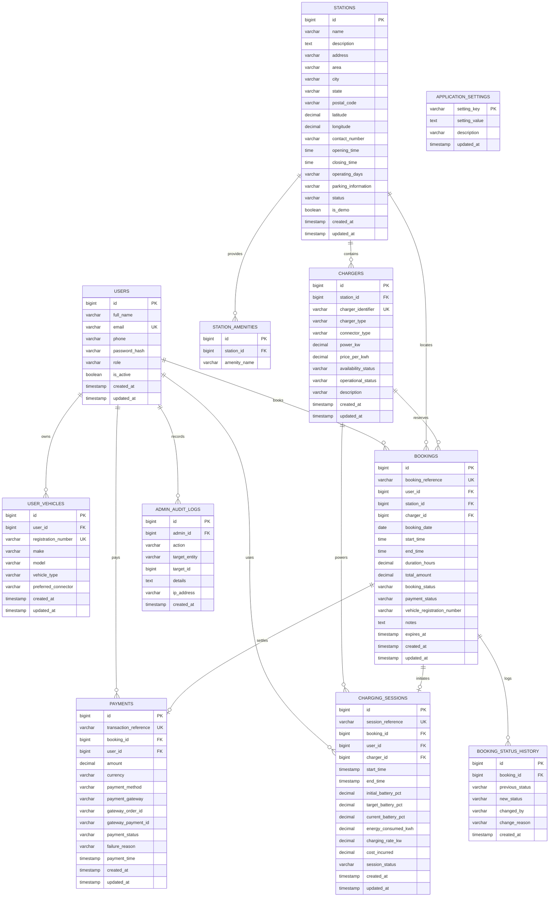

# Database Architecture & Design Specification

## System Overview
- **Database Engine**: MySQL 8.x (InnoDB Storage Engine)
- **Database Name**: `ev_charging_db`
- **Character Set**: `utf8mb4`
- **Collation**: `utf8mb4_unicode_ci`
- **Data Access Layer**: Spring JDBC (`NamedParameterJdbcTemplate` / `JdbcTemplate`)
- **Persistence Policy**: **Pure JDBC** — strictly no JPA, Hibernate, or ORM frameworks.

---

## Entity-Relationship (ER) Diagram



---

## Detailed Table Specifications

### 1. `users`
Stores registered EV vehicle owners and system administrators.
- `id` (BIGINT, PK, AUTO_INCREMENT): Unique user identifier.
- `full_name` (VARCHAR(100), NOT NULL): Legal full name.
- `email` (VARCHAR(150), NOT NULL, UNIQUE): Unique email used as principal for login.
- `phone` (VARCHAR(20), NOT NULL): Contact phone number.
- `password_hash` (VARCHAR(255), NOT NULL): BCrypt hashed password (`$2a$10$...`).
- `role` (VARCHAR(20), NOT NULL, DEFAULT 'ROLE_USER'): Spring Security authority (`ROLE_USER` or `ROLE_ADMIN`).
- `is_active` (BOOLEAN, NOT NULL, DEFAULT TRUE): Flag indicating account active status.
- `created_at`, `updated_at` (TIMESTAMP): Automatic audit timestamps.

### 2. `user_vehicles`
Stores EV vehicle specs associated with registered user profiles.
- `id` (BIGINT, PK, AUTO_INCREMENT): Vehicle identifier.
- `user_id` (BIGINT, FK -> `users.id`, ON DELETE CASCADE): Vehicle owner.
- `registration_number` (VARCHAR(50), NOT NULL, UNIQUE): Official license plate.
- `make` (VARCHAR(50), NOT NULL): Manufacturer (e.g., Tata, MG, Hyundai).
- `model` (VARCHAR(100), NOT NULL): Model name (e.g., Nexon EV, Ioniq 5).
- `vehicle_type` (VARCHAR(50), NOT NULL): 2-Wheeler, 3-Wheeler, 4-Wheeler Car, 4-Wheeler SUV, Commercial.
- `preferred_connector` (VARCHAR(50), NOT NULL): CCS2, Type 2, CHAdeMO, GB/T, 15A Socket.

### 3. `stations`
Physical EV charging locations with geographic coordinates and operational hours.
- `id` (BIGINT, PK, AUTO_INCREMENT): Station identifier.
- `name` (VARCHAR(150), NOT NULL): Station business name.
- `description` (TEXT): Overview and landmarks.
- `address` (VARCHAR(255), NOT NULL): Street address.
- `area` (VARCHAR(100), NOT NULL): Locality/neighborhood.
- `city` (VARCHAR(100), NOT NULL): City name (e.g., Kannur, Taliparamba, Thalassery, Kozhikode, Kochi).
- `state` (VARCHAR(100), NOT NULL): State (e.g., Kerala).
- `postal_code` (VARCHAR(20), NOT NULL): PIN / postal code.
- `latitude` (DECIMAL(10, 7), NOT NULL): Latitude in decimal degrees.
- `longitude` (DECIMAL(10, 7), NOT NULL): Longitude in decimal degrees.
- `contact_number` (VARCHAR(30), NOT NULL): On-site station support number.
- `opening_time` (TIME, NOT NULL, DEFAULT '00:00:00'): Daily opening time.
- `closing_time` (TIME, NOT NULL, DEFAULT '23:59:59'): Daily closing time.
- `operating_days` (VARCHAR(100), NOT NULL, DEFAULT 'All Days'): Operational schedule description.
- `parking_information` (VARCHAR(255)): Parking bay details.
- `status` (VARCHAR(30), NOT NULL, DEFAULT 'ACTIVE'): ACTIVE, MAINTENANCE, INACTIVE.
- `is_demo` (BOOLEAN, NOT NULL, DEFAULT FALSE): Clearly flags unverified mock demo stations.

### 4. `station_amenities`
Child table holding amenities available at each station.
- `id` (BIGINT, PK, AUTO_INCREMENT): Record ID.
- `station_id` (BIGINT, FK -> `stations.id`, ON DELETE CASCADE).
- `amenity_name` (VARCHAR(100), NOT NULL): e.g., Restroom, Coffee Shop, Free Wi-Fi, CCTV, 24/7 Security.

### 5. `chargers`
Individual charging units and charging guns attached to a station.
- `id` (BIGINT, PK, AUTO_INCREMENT): Charger record ID.
- `station_id` (BIGINT, FK -> `stations.id`, ON DELETE CASCADE): Station attachment.
- `charger_identifier` (VARCHAR(50), NOT NULL, UNIQUE): Unique hardware code (e.g., `KNR-CLX-DC01`).
- `charger_type` (VARCHAR(50), NOT NULL): AC Fast Charging, DC Fast Charging, Ultra-Fast DC.
- `connector_type` (VARCHAR(50), NOT NULL): CCS2, Type 2, CHAdeMO, GB/T, 15A Socket.
- `power_kw` (DECIMAL(6, 2), NOT NULL): Rated power in kilowatts (e.g., 7.4, 22.0, 50.0, 60.0, 150.0).
- `price_per_kwh` (DECIMAL(8, 2), NOT NULL): Pricing in INR per kilowatt-hour.
- `availability_status` (VARCHAR(30), NOT NULL, DEFAULT 'AVAILABLE'): AVAILABLE, IN_USE, RESERVED, OFFLINE.
- `operational_status` (VARCHAR(30), NOT NULL, DEFAULT 'OPERATIONAL'): OPERATIONAL, FAULTY, UNDER_MAINTENANCE.

### 6. `bookings`
Time-slot reservations made by users.
- `id` (BIGINT, PK, AUTO_INCREMENT): Internal booking ID.
- `booking_reference` (VARCHAR(30), NOT NULL, UNIQUE): Public unique reference (format: `EVC-YYYYMMDD-XXXXXX`).
- `user_id` (BIGINT, FK -> `users.id`): Reserving user.
- `station_id` (BIGINT, FK -> `stations.id`): Reserved station.
- `charger_id` (BIGINT, FK -> `chargers.id`): Reserved charger.
- `booking_date` (DATE, NOT NULL): Target reservation date.
- `start_time` (TIME, NOT NULL): Slot commencement time.
- `end_time` (TIME, NOT NULL): Slot termination time.
- `duration_hours` (DECIMAL(4, 2), NOT NULL): Computed booking duration.
- `total_amount` (DECIMAL(10, 2), NOT NULL): Computed estimated price.
- `booking_status` (VARCHAR(30), NOT NULL): PENDING_PAYMENT, CONFIRMED, COMPLETED, CANCELLED, EXPIRED.
- `payment_status` (VARCHAR(30), NOT NULL): UNPAID, PAID, REFUNDED.
- `vehicle_registration_number` (VARCHAR(50)): Vehicle linked to session.
- `notes` (TEXT): Special booking instructions.
- `expires_at` (TIMESTAMP): Auto-cancellation expiration deadline for unpaid reservations (15 minutes).

### 7. `payments`
Financial transactions for slot bookings.
- `id` (BIGINT, PK, AUTO_INCREMENT): Payment record ID.
- `transaction_reference` (VARCHAR(40), NOT NULL, UNIQUE): Unique transaction ID (format: `PAY-YYYYMMDD-XXXXXXXX`).
- `booking_id` (BIGINT, FK -> `bookings.id`): Linked booking.
- `user_id` (BIGINT, FK -> `users.id`): Paying customer.
- `amount` (DECIMAL(10, 2), NOT NULL): Amount paid in INR.
- `currency` (VARCHAR(10), NOT NULL, DEFAULT 'INR'): Currency code.
- `payment_method` (VARCHAR(50), NOT NULL): UPI, CREDIT_CARD, DEBIT_CARD, NET_BANKING, WALLET.
- `payment_gateway` (VARCHAR(50), NOT NULL): DEMO_SIMULATOR or RAZORPAY.
- `gateway_order_id` (VARCHAR(100)): External or simulated order identifier.
- `gateway_payment_id` (VARCHAR(100)): External or simulated gateway payment identifier.
- `payment_status` (VARCHAR(30), NOT NULL): SUCCESS, FAILED, PENDING, REFUNDED.
- `failure_reason` (VARCHAR(255)): Error message when payment fails.
- `payment_time` (TIMESTAMP): Time when payment confirmation was processed.

### 8. `charging_sessions`
Live or historical telemetry and actual energy delivery records.
- `id` (BIGINT, PK, AUTO_INCREMENT): Session ID.
- `session_reference` (VARCHAR(40), NOT NULL, UNIQUE): Format: `SES-YYYYMMDD-XXXXXXXX`.
- `booking_id` (BIGINT, FK -> `bookings.id`): Associated reservation.
- `user_id` (BIGINT, FK -> `users.id`): Active vehicle driver.
- `charger_id` (BIGINT, FK -> `chargers.id`): Active physical charger.
- `start_time` (TIMESTAMP): Physical charging plug-in timestamp.
- `end_time` (TIMESTAMP): Unplug timestamp.
- `initial_battery_pct` (DECIMAL(5, 2)): Battery level at plug-in (%).
- `target_battery_pct` (DECIMAL(5, 2)): Desired target battery level (%).
- `current_battery_pct` (DECIMAL(5, 2)): Live progress battery level (%).
- `energy_consumed_kwh` (DECIMAL(8, 2)): Cumulative energy dispensed.
- `charging_rate_kw` (DECIMAL(6, 2)): Real-time charging rate.
- `cost_incurred` (DECIMAL(10, 2)): Calculated cost based on energy used.
- `session_status` (VARCHAR(30), NOT NULL): NOT_STARTED, IN_PROGRESS, COMPLETED, STOPPED_EARLY, FAULTED.

### 9. `booking_status_history`
Lifecycle state transitions for reservations.
- Tracks transitions: PENDING_PAYMENT -> CONFIRMED -> IN_PROGRESS -> COMPLETED or CANCELLED with actor and audit reason.

### 10. `admin_audit_logs`
Compliance and security logs tracking administrative changes.
- Records administrator ID, action name (STATION_CREATE, CHARGER_STATUS_UPDATE, etc.), affected entity, timestamp, and client IP.

### 11. `application_settings`
Key-value runtime configuration parameters.
- Holds cancellation window thresholds, tax rates, contact hotline numbers, and feature switches.

---

## Concurrency Control & Double-Booking Prevention

### 1. Row-Level Pessimistic Locking
When booking confirmation begins inside `@Transactional`, the system locks the target charger:
```sql
SELECT id, availability_status, operational_status
FROM chargers
WHERE id = :chargerId
FOR UPDATE;
```

### 2. Overlap Query Verification
Before committing a booking, Spring JDBC executes an interval intersection check:
```sql
SELECT COUNT(*) FROM bookings
WHERE charger_id = :chargerId
  AND booking_date = :bookingDate
  AND booking_status IN ('CONFIRMED', 'PENDING_PAYMENT', 'IN_PROGRESS')
  AND NOT (start_time >= :endTime OR end_time <= :startTime);
```
If the count exceeds 0, a `SlotUnavailableException` is thrown, rolling back the transaction.

### 3. Automatic Cleanup of Unpaid Bookings
Unpaid bookings have an `expires_at` timestamp (15 minutes from creation). A Spring `@Scheduled` background worker executes periodically:
```sql
UPDATE bookings
SET booking_status = 'EXPIRED'
WHERE booking_status = 'PENDING_PAYMENT'
  AND expires_at < NOW();
```
This automatically restores slot capacity if a user abandons checkout.

---

## Spring JDBC Data Access Pattern

Every repository injects `NamedParameterJdbcTemplate` and `JdbcTemplate` without JPA entities or lazy loading:
- **Explicit RowMappers**: Every entity has a dedicated `RowMapper<T>` implementation.
- **SQL Queries**: Externalized and strictly parameterized with `MapSqlParameterSource` to prevent SQL Injection.
- **Explicit Primary Key Generation**: `KeyHolder` and `GeneratedKeyHolder` used on `INSERT` statements.
